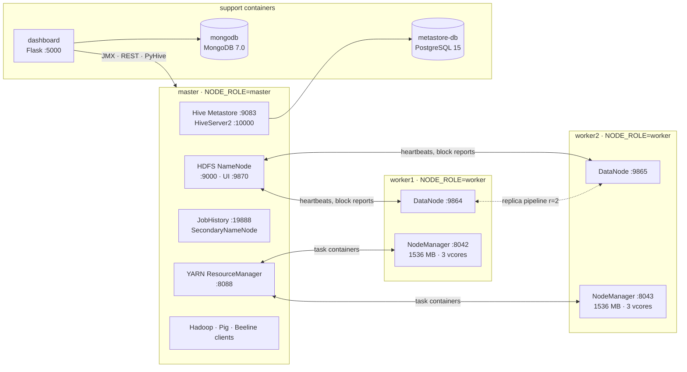

<!-- ============================== COVER PAGE ============================== -->

**VISVESVARAYA TECHNOLOGICAL UNIVERSITY**
Jnana Sangama, Santhibastawad Road, Machhe, Belagavi – 590018, Karnataka, India

**Big Data Analytics**
2022 SCHEME – BCS714D

**ASSIGNMENT 2 REPORT**
ON

**"Distributed Big Data Analytics of NOAA GHCN-Daily Climate Records using MongoDB, Hadoop MapReduce, Apache Pig and Apache Hive on a Multi-Node Cluster"**

Submitted as part of the coursework for Big Data Analytics

**BACHELOR OF ENGINEERING**
in
**COMPUTER SCIENCE AND ENGINEERING**

For the Academic Year 2026 – 2027

**Team No: 16**

| Name | USN | Signature |
|---|---|---|
| Deeptanshu Pandey | 1JS23CS044 | |
| Chirag S | 1JS23CS039 | |
| Gagan Surendra Shamnur | 1JS23CS052 | |

**Faculty:** Ms. Sandhiya B, Assistant Professor, Dept. of CSE

Signature of the Faculty: ____________   Signature of HOD: ____________

Department of Computer Science and Engineering, JSS Academy of Technical Education,
JSS Campus Rd, Dr. Vishnuvardhan Road, Bengaluru – 560060

<!-- ============================== TABLE OF CONTENTS ============================== -->

## TABLE OF CONTENTS – ASSIGNMENT 2

| S. No. | Section Title | Page No. |
|---|---|---|
| 1 | Introduction and Objectives | |
| 2 | Dataset Description | |
| 3 | Distributed Computing Environment Setup | |
| 4 | Implementation of the Selected Practical Extension | |
| 5 | Analysis, Results, and Discussion | |
| 6 | Performance Evaluation | |
| 7 | Conclusion | |
| 8 | References | |
| 9 | Appendices – Code and Screenshots | |

---

## 1. Introduction and Objectives

### 1.1 Introduction

Weather stations around the world record temperature, rainfall and snow every day. The NOAA Global Historical Climatology Network – Daily (GHCN-Daily) collects these readings from more than 130,000 stations into one archive. It is used for climate monitoring, agriculture planning and disaster studies. A single recent year has about 37 million observations, and the full archive covers more than two centuries, so the data cannot be analysed comfortably with one process on one machine. It is a natural case for distributed storage and processing.

In this assignment we built a **three-node Hadoop cluster** (one master and two workers) using Docker. We stored three years of GHCN-Daily records (113 million observations, 3.8 GB uncompressed) in HDFS and analysed them with four complementary tools:

- **Hadoop MapReduce** (Java and Python Streaming) for batch aggregation;
- **Apache Pig** for cleaning and transformation (ETL);
- **Apache Hive** for SQL analysis, where we compared the row-oriented TEXTFILE format with the columnar RCFile format;
- **MongoDB** for document storage, indexing, aggregation pipelines and geospatial queries.

For the practical extension (Part 2) we built a **Flask web dashboard**. It shows the live state of the cluster from the Hadoop REST APIs, charts the MongoDB aggregation results, puts the stations on a map using a 2dsphere index, runs predefined Hive queries through HiveServer2, and visualises the performance results of Part 1.

### 1.2 Objectives

**Part 1 – Core themes**
1. Build a reproducible multi-node cluster: HDFS with replication factor 2 over two DataNodes, YARN with two NodeManagers, plus the JobHistory server, Hive Metastore/HiveServer2 and Pig. The same project must deploy on one laptop (Mode A) and on three real machines (Mode B).
2. **Theme 1 – MongoDB:** design a document model for station-day observations, ingest the data in batches, create compound, multikey and 2dsphere indexes, write at least six aggregation pipelines (`$match`, `$group`, `$project`, `$unwind`, `$facet`, `$lookup`, `$bucket`, `$geoNear`), and profile key queries with `explain("executionStats")` before and after indexing.
3. **Theme 2 – Hadoop:** demonstrate HDFS file management and prove block replication across both workers. Implement MapReduce jobs in Java (custom Writable, Combiner, custom counters) and in Python Streaming, run them on YARN, and show which node ran each task.
4. **Theme 3 – Pig and Hive:** clean the raw data with Pig in MapReduce mode, load it into Hive as TEXTFILE and RCFile tables, and benchmark an identical set of queries on both, measuring time, HDFS bytes read and storage size.

**Part 2 – Practical extension (Option 3: Web Dashboard and Visualization)**

5. Build a Flask dashboard with five pages: cluster overview, climate analytics, station map, Hive queries and performance comparison. It must have a clean responsive UI and clear error messages when a service is down.

---

## 2. Dataset Description

### 2.1 Source and ownership

| Item | Value |
|---|---|
| Name | Global Historical Climatology Network – Daily (GHCN-Daily), version 3 |
| Owner / publisher | NOAA National Centers for Environmental Information (NCEI), USA |
| Access | https://www.ncei.noaa.gov/pub/data/ghcn/daily/ (public domain, no registration) |
| Files used | `by_year/2023.csv.gz`, `2024.csv.gz`, `2025.csv.gz`; `ghcnd-stations.txt`; `ghcnd-countries.txt`; `ghcnd-inventory.txt` |
| Subset chosen | the three most recent complete years, 2023–2025 (configurable in `.env`) |
| Download date | 27 October 2026 |

### 2.2 Record format

Each `by_year` file is a header-less CSV with **one row per station, per day, per element**:

| # | Field | Example | Description |
|---|---|---|---|
| 1 | ID | `IN009010100` | 11-character station id; the first 2 characters are the FIPS **country code** (`IN` = India) |
| 2 | DATE | `20250514` | observation date, YYYYMMDD |
| 3 | ELEMENT | `TMAX` | measured quantity (see 2.3) |
| 4 | DATA_VALUE | `412` | integer value in the element's unit; `-9999` = missing |
| 5 | M_FLAG | `T` | measurement flag (e.g. T = trace precipitation) |
| 6 | Q_FLAG | *(empty)* | **quality flag – empty means the value passed all QC checks; any letter means it failed** |
| 7 | S_FLAG | `S` | source flag (which archive supplied the value) |
| 8 | OBS_TIME | `0700` | observation time HHMM (often empty) |

The station file `ghcnd-stations.txt` is **fixed-width**:

| Columns | Field |
|---|---|
| 1–11 | ID |
| 13–20 | latitude |
| 22–30 | longitude |
| 32–37 | elevation (m) |
| 39–40 | US state |
| 42–71 | name |
| 73–75 | GSN flag |
| 77–79 | HCN/CRN flag |
| 81–85 | WMO id |

Our `prepare_stations.py` converts it into a quoted CSV, a tab-separated file for Hive/Pig, and JSON Lines with a GeoJSON `location: {type: "Point", coordinates: [lon, lat]}` for MongoDB.

### 2.3 Elements and units

| Element | Meaning | Raw unit | After cleaning |
|---|---|---|---|
| TMAX | daily maximum temperature | tenths of °C | °C |
| TMIN | daily minimum temperature | tenths of °C | °C |
| PRCP | precipitation | tenths of mm | mm |
| SNOW | snowfall | mm | mm |
| SNWD | snow depth | mm | mm |

These five "core" elements make up 76.9 % of all rows. The other 60+ elements (TAVG, TOBS, wind, evaporation, …) are ignored in the analysis.

### 2.4 Size and content of the chosen subset

Measured by `scripts/dataset_stats.py` (`results/dataset_stats.csv`):

| Year | Records | Core-element records | QC-failed (non-empty Q_FLAG) | Stations | Countries | .gz size (MB) | Uncompressed (MB) |
|---|---|---|---|---|---|---|---|
| 2023 | 38,293,556 | 29,069,188 | 42,221 | 44,415 | 195 | 167.9 | 1,312.6 |
| 2024 | 38,470,116 | 29,273,951 | 36,875 | 44,882 | 195 | 168.3 | 1,319.3 |
| 2025 | 36,371,852 | 28,612,442 | 46,383 | 44,531 | 198 | 158.3 | 1,250.2 |
| **Total** | **113,135,524** | **86,955,581** | **125,479** | **49,733 distinct** | **200 distinct** | **494.5** | **3,882.1** |

Records per element (all three years): PRCP 33.75 M, SNOW 17.09 M, TMAX 13.12 M, TMIN 13.12 M, SNWD 9.88 M, TAVG 6.52 M, TOBS 4.67 M. The station metadata lists **133,039 stations in 218 countries/territories**. Only 49,733 of them reported anything in 2023–2025.

### 2.5 Why this is "big data"

- **Volume.** The three-year subset alone is 113 M rows (3.9 GB as text, 7.7 GB in HDFS with two replicas). The full archive (1750–today) is several billion rows and over 100 GB uncompressed. One year of the station-day MongoDB model is ≈ 12 M documents. A single-threaded script needs minutes just to read the data once. Our cluster reads it with 122 parallel map tasks.
- **Velocity.** NCEI refreshes the current-year file **every day** with new observations from tens of thousands of stations. Any pipeline must handle continuous appends and periodic re-processing.
- **Variety.** The archive mixes a fixed-width text format (stations), CSV (observations), coded flags, more than 60 element types with different units, and data from many source networks of very different quality. One example is US CoCoRaHS volunteer rain gauges, which are 46 % of the station-days but report rainfall only. Readings are also spatial (lat/lon), which needs geospatial indexing.
- **Veracity.** 125,479 values carry a QC-failure flag, and missing values are encoded as `-9999`. Both must be filtered before analysis, which is why we added the Pig cleaning step.

---

## 3. Distributed Computing Environment Setup

### 3.1 Architecture

We did not have three physical machines, so we built the cluster from **Docker containers on one laptop**. Each node is a separate container with its own hostname, IP address, filesystem and processes. HDFS and YARN therefore see three distinct hosts that communicate only over a network, exactly as on real machines.

Mermaid source (report/diagrams/architecture.mmd)

| Node (container) | Hostname | Services | Host ports |
|---|---|---|---|
| Master | `master` | NameNode, SecondaryNameNode, ResourceManager, JobHistory Server, Hive Metastore, HiveServer2, Pig/Hadoop/Beeline clients | 9870, 9000, 8088, 19888, 10000, 10002 |
| Worker 1 | `worker1` | DataNode, NodeManager | 9864, 8042 |
| Worker 2 | `worker2` | DataNode, NodeManager | 9865, 8043 |
| Support | `metastore-db` | PostgreSQL 15.8 (Hive metastore) | – |
| Support | `mongodb` | MongoDB 7.0.14 | 27017 |
| Support | `dashboard` | Flask 3 + Gunicorn (Part 2) | 5000 |

The data flow through the system is shown in Fig. 2.

### 3.2 Docker design decisions

1. **One custom image for every Hadoop node** (`docker/hadoop/Dockerfile`, base `eclipse-temurin:8-jdk-jammy`). It contains Hadoop 3.3.6, Hive 3.1.3 and Pig 0.18.0. The node's role is chosen at start-up by the environment variable `NODE_ROLE=master|worker`, and `entrypoint.sh` starts the matching daemons. We did not use third-party Hadoop images, because most of them are unmaintained and pinned to Hadoop 2.
2. **Configuration from templates.** `core-site.xml`, `hdfs-site.xml`, `yarn-site.xml`, `mapred-site.xml`, `hive-site.xml` and `workers` are generated at container start by `render-config.sh`. It uses `envsubst` restricted to our own variables, so Hadoop's internal `${...}` expressions are not touched. All values come from **one `.env` file**: master hostname, worker list, replication, block size, YARN memory, metastore credentials. Moving to three machines only means editing `.env`. The native installer reuses the same templates.
3. **First-run detection.** The NameNode is formatted only when its volume has no `current/VERSION` file, so restarts never wipe HDFS. The Hive metastore schema is created only when `schematool -info` fails.
4. **Named volumes** (`namenode`, `datanode1`, `datanode2`, `mongo-data`, `pg-data`) keep HDFS, MongoDB and metastore data across restarts. `reset-cluster.ps1` deletes them after a typed confirmation.
5. **Tarballs bind-mounted at build time** (`RUN --mount=type=bind`) so the 1.5 GB of downloads do not stay inside image layers. The Hadoop documentation folder is removed, which saves about 500 MB.
6. **Windows specifics.** `.gitattributes` forces LF endings for `*.sh *.xml *.pig *.hql *.py`, and the Dockerfile additionally strips `\r` from its scripts. WSL2 memory is set in `%UserProfile%\.wslconfig` (`memory=8GB`).

### 3.3 Software versions

| Component | Version | Notes |
|---|---|---|
| Docker Desktop / Engine | 29.6.1, Compose v5.3 | WSL2 backend, 8 CPUs, 7.66 GiB visible to Docker |
| JDK | Eclipse Temurin 8 | Hive 3.1.x officially supports Java 8 only |
| Hadoop | 3.3.6 | HDFS, YARN, MapReduce 2 |
| Hive | 3.1.3 | MapReduce execution engine; metastore on PostgreSQL 15.8 (JDBC 42.7.4) |
| Pig | 0.18.0 (`-h3` core jar) | first official Pig release built against Hadoop 3 |
| MongoDB | 7.0.14 | WiredTiger cache limited to 0.5 GB |
| Python | 3.12 (tools/dashboard), 3.10 (workers, for Streaming) | pymongo 4.8, PyHive 0.7, Flask 3.0, pandas 2.2, matplotlib 3.9 |
| Maven | 3.9.9 (container `maven:3.9.9-eclipse-temurin-8`) | builds the MapReduce jar without installing Maven on Windows |
| Front-end | Bootstrap 5.3.3, Chart.js 4.4.4, Leaflet 1.9.4 | vendored into `dashboard/static/vendor` so the demo works offline |

**Compatibility issues we handled:**
- **Guava conflict.** Hive 3.1.3 ships `guava-19.0.jar`, while Hadoop 3.3.6 needs Guava 27. With both on the classpath, HiveServer2 and `schematool` fail with `NoSuchMethodError: com.google.common.base.Preconditions.checkArgument`. The Dockerfile deletes Hive's Guava 19 and copies Hadoop's `guava-27.0-jre.jar` into `$HIVE_HOME/lib`.
- **Duplicate SLF4J bindings.** We removed Hive's `log4j-slf4j-impl`.
- **Pig 0.17 vs Hadoop 3.** Pig 0.17 only ships a Hadoop 2 build. We used Pig 0.18.0, whose `pig-0.18.0-core-h3.jar` runs natively on Hadoop 3 in MapReduce mode.
- **Hadoop 3 refuses to start daemons as root.** We set `HDFS_*_USER`/`YARN_*_USER=root` explicitly.
- **Hive 3.1.3 is no longer on the Apache CDN.** `archive.apache.org` served it at about 8 KB/s, so we used a public mirror and verified the file against Apache's SHA-256 checksum (`0c9b6a63…bb16`).

### 3.4 HDFS and YARN configuration

| Setting | Value | Reason |
|---|---|---|
| `dfs.replication` | 2 | one replica on each worker → survives the loss of either worker |
| `dfs.blocksize` | 32 MB (33,554,432) | 3.8 GB → 122 blocks/splits, so both workers get many map tasks (default 128 MB would give only ~31) |
| `yarn.nodemanager.resource.memory-mb` | 1536 per worker | 3 GB of YARN memory in total, fitting into 8 GB with all other services |
| `yarn.scheduler.minimum/maximum-allocation-mb` | 256 / 1536 | |
| `mapreduce.map/reduce.memory.mb` | 512 (heap `-Xmx400m`) | ~80 % of the container for heap, rest for JVM overhead |
| `yarn.app.mapreduce.am.resource.mb` | 512 | → 1 AM + 5 task containers can run at the same time |
| Daemon heaps | NameNode/RM/DN/NM 384 MB, SNN/JHS 256 MB, Metastore 512 MB, HiveServer2 1 GB | |
| `yarn.nodemanager.vmem-check-enabled` | false | JVMs reserve large virtual memory under WSL2; the check kills healthy tasks |
| disk health threshold | 98.5 % | all containers share one Docker disk |
| log aggregation | enabled | task logs visible in JobHistory after the job ends |

**Laptop memory budget (measured with `docker stats`):** master ≈ 2.3 GB, each worker ≈ 0.6 GB idle and up to 2.1 GB while running tasks, MongoDB ≤ 1 GB, PostgreSQL + dashboard ≈ 0.15 GB. The total stays within the 7.66 GiB WSL2 VM.

### 3.5 Deployment modes

**Mode A – one laptop (used for all results in this report).** `docker-compose.yml` starts all six containers on the bridge network `bda16-net`. `.\scripts\start-cluster.ps1` builds the images if they are missing, starts the containers, and polls `hdfs dfsadmin -report` and `yarn node -list` until **2 live DataNodes and 2 RUNNING NodeManagers** are reported. It then waits for HiveServer2 (Fig. A1–A13 in the appendix). Other scripts: `cluster-status.ps1`, `stop-cluster.ps1`, `reset-cluster.ps1`.

**Mode B – three real machines.** The image and service names stay the same. Only `.env` (the three IP addresses) changes.

- *Recommended:* `docker swarm init` on the master, `docker swarm join` on the workers, and one attachable overlay network `bda16-overlay`. Then `docker-compose.master.yml` runs on the master and `docker-compose.worker.yml` (with `WORKER_NAME=worker1|worker2`) on each worker. Containers on different machines resolve each other by name over the overlay, so no Hadoop configuration changes.
- *Alternative:* `docker-stack.yml` deploys the whole stack from the master with `node.labels.role` placement constraints.
- *Fallback without Docker:* `install-native.sh master|worker1|worker2` for Ubuntu 22.04/WSL2. It installs the same versions, writes `/etc/hosts`, creates a `hadoop` user with passwordless SSH, and renders the same templates. `native-start.sh` then uses `start-dfs.sh`/`start-yarn.sh`.

The full step-by-step guide, firewall rules (2377/tcp, 7946/tcp+udp, 4789/udp, Hadoop ports) and `Test-NetConnection` checks are in `report/mode-b-guide.md`. We validated the Mode B compose and stack files with `docker compose config`, but could not run them on three physical machines.

### 3.6 Proof that three nodes work together

| Evidence | Where | Result |
|---|---|---|
| `hdfs dfsadmin -report` | Fig. A2 | **Live datanodes (2)**: worker1 and worker2, both In Service |
| `yarn node -list -all` | Fig. A3 | **Total Nodes: 2**, both RUNNING |
| `jps` on each container | Fig. A3 | NameNode, SecondaryNameNode, ResourceManager, JobHistoryServer, 2 × RunJar (Hive) on master; DataNode + NodeManager on each worker |
| NameNode UI → Datanodes | Fig. A6 | both workers listed, similar block counts |
| `hdfs fsck … -locations` / file browser | Fig. A17, A18, A20 | every block has `Live_repl=2`, one copy on each worker (126 replicas per worker for /ghcn) |
| JobHistory attempts page | Fig. A31, A35 | map/reduce attempts alternate between `worker1:8042` and `worker2:8042` |
| JobHistory REST (`mr_task_nodes.csv`) | Fig. A27 | Job 1: 49 maps on worker1, 73 on worker2; Job 2: 67 / 55 |
| Dashboard Cluster page | Fig. B1 | live node cards for master, worker1, worker2 |

